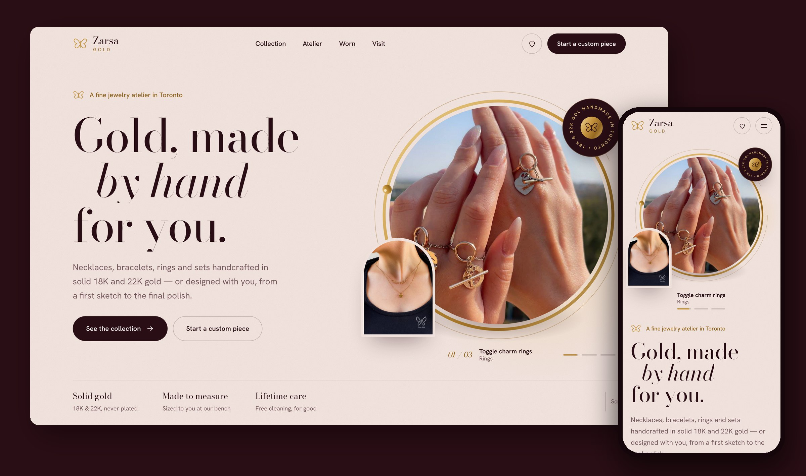
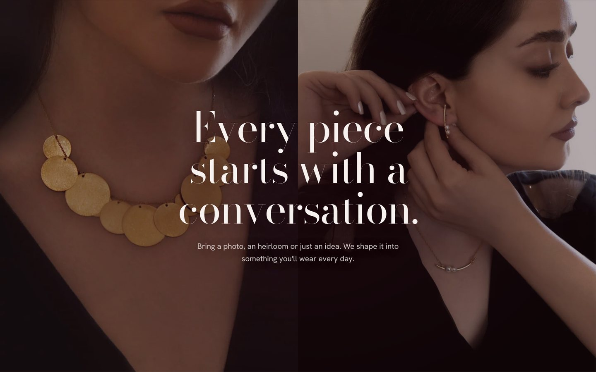
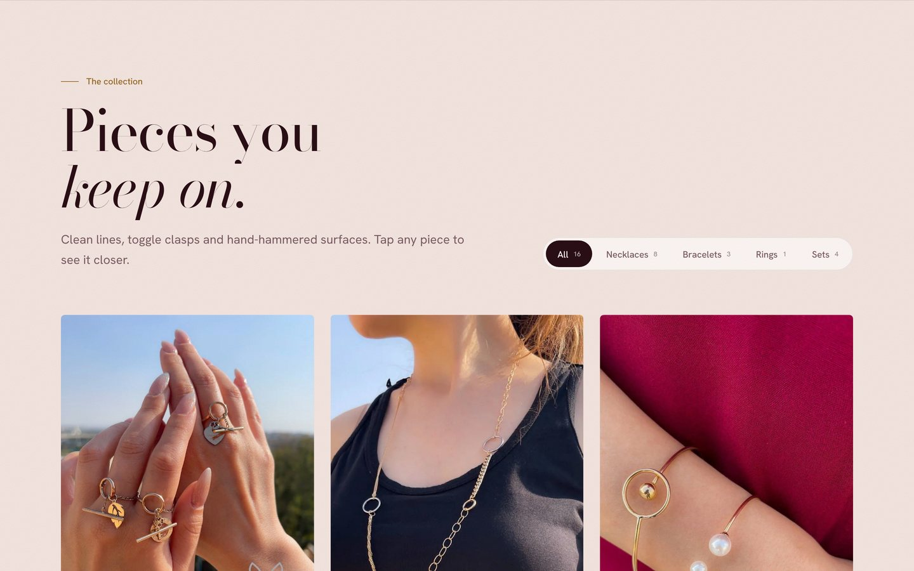

<div align="center">

# 💍 Zarsa Gold — Bespoke Fine Jewelry

A luxury, motion-rich website for a Toronto fine-jewelry atelier: an editorial collection, a scroll-driven reveal and a custom-order form.

<a href="https://zarsa.ca/"></a>
<a href="https://github.com/miladmo68/zarsa2"></a>
<a href="https://miladweb.com"></a>

**🔗 Live:** [zarsa.ca](https://zarsa.ca/)

</div>

<p align="center">
  
</p>

<p align="center">
  
  
</p>

## ✨ Features

- **Signature hero** — a circular window that draws itself in gold, letter-by-letter headline, a rotating "Handmade in Toronto" seal, an arch detail photo and a synced featured-piece carousel
- **Scroll-driven reveal** — a circle that grows into a full-screen diptych as you scroll
- **Editorial collection** — balanced masonry grid, animated filter pill, image clip reveals and a custom "View" cursor
- **Lightbox** — keyboard, swipe and focus-trap support, piece descriptions, 18K / 22K choice and "Ask about this piece", which pre-fills the order form
- **Saved pieces** — heart any piece; your saved list shows in the nav and is sent with your request
- **Shop by how you wear it** — Layer it, Stack it, Gift a set and Mark a moment entry points
- **Atelier story** — a four-step process, promises and a parallax photo collage
- **Custom-order form** — floating labels, category chips, drag-and-drop reference upload and clear validation; sent with Resend through a Vercel serverless function
- **Mobile-first** — full-screen circular menu, a sticky order button and swipeable rails
- **Fast and accessible** — self-hosted fonts, responsive WebP images, Lenis smooth scroll, `prefers-reduced-motion` support and visible keyboard focus

## 🛠️ Tech Stack

    

## 🚀 Getting Started

**Prerequisites:** [Node.js](https://nodejs.org/) 18 or newer

**Install and run**

```bash
git clone https://github.com/miladmo68/zarsa2.git
cd zarsa2
npm install
npm run dev
```

### Environment variables

Create a `.env` file (or `.env.local` for Next.js) with:

```env
CONTACT_BCC=
CONTACT_FROM=
CONTACT_TO=
RESEND_API_KEY=
```

## 📁 Project Structure

```
zarsa2/
├── api/            # contact.js — Resend email handler
├── assets/         # original photos, img/ (WebP sizes), fonts/
├── css/style.css
├── js/main.js      # motion & interactions (vendor/lenis.min.js)
├── index.html
├── package.json
└── vercel.json
```

## 👤 Author

**Milad Mohammadi** — Frontend-Focused Full-Stack Developer, Toronto 🇨🇦

[](https://miladweb.com)
[](https://www.linkedin.com/in/miladmo68/)
[](https://github.com/miladmo68)

<p align="center"><sub>If you like this project, consider giving it a ⭐</sub></p>
